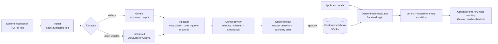

# Paatrata · पात्रता

**Welfare rules anyone can check.**
Paatrata compiles government welfare-scheme notifications into tested, clause-cited eligibility rules that an officer
approves, then answers every applicant the same way, with the sentence of the notification each answer rests on.

[](LICENSE)


Built by team **clawops** for **Code for Communities Chandigarh** (GDG Cloud Chandigarh), theme: *AI for Digital Public
Infrastructure of Chandigarh*, plus the Best Open-Source AI Project bonus challenge.
See **[PROJECT_OVERVIEW.md](PROJECT_OVERVIEW.md)** for the problem statement and how the project maps to the judging criteria.

> **Status:** working prototype. Six Chandigarh schemes are included as *secondary* summaries; five of their
> answer keys are drafts awaiting human verification. Nothing here is an official eligibility decision.

---

## Contents

1. [The problem](#the-problem)
2. [The idea: compile once, decide with code](#the-idea-compile-once-decide-with-code)
3. [How it works](#how-it-works)
4. [Where Google AI does the work](#where-google-ai-does-the-work)
5. [Quickstart](#quickstart)
6. [Using the app](#using-the-app)
7. [Command line](#command-line)
8. [Using the library](#using-the-library)
9. [Agent Skill](#agent-skill)
10. [REST API](#rest-api)
11. [Evaluation](#evaluation)
12. [Data and provenance](#data-and-provenance)
13. [Rule format](#rule-format)
14. [Project structure](#project-structure)
15. [Configuration](#configuration)
16. [Testing](#testing)
17. [Deployment](#deployment)
18. [Security and privacy](#security-and-privacy)
19. [Limitations](#limitations)
20. [Roadmap](#roadmap)
21. [Troubleshooting](#troubleshooting)
22. [Licence and credits](#licence-and-credits)

---

## The problem

Eligibility for welfare schemes is written as prose in notifications and portal summaries: *"The family annual income
of the applicant should not exceed Rs. 1,50,000"*, *"resident of UT Chandigarh for more than 3 years"*. Every portal,
helpdesk and chatbot re-reads that prose and re-interprets it by hand. The results:

- **Answers drift.** Two channels, or the same chatbot asked twice, can give different answers.
- **Answers can't be traced.** A citizen told "not eligible" rarely learns which clause, or which reading of it, decided that.
- **Ambiguity is silently guessed.** Does "family" include adult sons living separately? Is "18–60 years" inclusive?
  Someone decides, nobody records it.
- **Updates go stale.** When a circular changes an income ceiling, every downstream encoding has to be found and fixed.

Chandigarh is a sharp case: as a Union Territory it runs its own pensions and child-support schemes next to central
ones, so a resident faces two rulebooks. The same problem exists in every state; one private provider alone lists more
than 5,000 schemes across India ([NITI Aayog Frontier Tech](https://frontiertech.niti.gov.in/story/a-revolution-for-indias-welfare-how-ai-is-helping-families-access-public-schemes/)).

Existing tools (myScheme, Haqdarshak, Indus Action's eligibility engines) do discovery and eligibility well at the
citizen end. Paatrata works one step upstream: turning the **document** into **verified, machine-executable rules**.

## The idea: compile once, decide with code

Paatrata uses a large language model as a **compiler**, not an oracle.

| | Typical scheme chatbot | Paatrata |
|---|---|---|
| When does the model run? | On every question | Once per document, at authoring time |
| Who decides eligibility? | The model, each time | A small deterministic engine |
| Same question twice | Can differ | Always identical |
| Why this answer? | Free-text reasoning | The exact clause, page and quote for every condition |
| Unclear wording | Silently guessed | Flagged as a question; blocks approval until an officer answers |
| Missing applicant facts | Often guessed | "Needs more information", naming the missing fact |
| Rule changes | Re-prompt and hope | New version, re-run the boundary tests |

## How it works



**1. Ingest.** The document is split into page-numbered text (`pdfplumber`). Scanned PDFs with no text layer are sent
to Gemini as PDF instead, and flagged because their quotes cannot be verified locally.

**2. Extract.** Gemini is called with a fixed JSON schema (Pydantic → structured output). For every eligibility
condition it must return: a field from a controlled vocabulary, an operator, the value as written, a normalised value,
a **verbatim quote**, the page, a confidence, and, when the wording is unclear, **one question for the officer**.
The prompt includes an explicit ambiguity checklist (undefined terms, unclear range ends, missing reference dates,
who a condition applies to, conditions implied only by the title, conflicts between sections). Conditions that cannot
be expressed with the vocabulary (*"of good character"*) go to a separate *needs human verification* list instead of
being forced into a field.

**3. Validate (code, no AI).** Each condition is rejected unless:
- its field exists in the vocabulary and the operator is legal for that field type;
- its value normalises deterministically (`"Rs. 1.5 lakh"` → `150000`, `"one lakh fifty thousand"` → `150000`);
- its quote is actually found in the source (fuzzy match ≥ 90%); a wrong page number is corrected and noted.

The validator also detects contradictions (`age ≥ 60` and `age ≤ 50` in the same ALL group) and repairs a malformed
group tree.

**4. Review.** A second, independent Gemini pass reads the compiled conditions against the source and reports only
three things: *missing* conditions, *misread* conditions (wrong field, operator or value) and *ambiguities*. Every
finding must quote the source; findings whose quote cannot be found are discarded. Ambiguities and possible misreads
are attached to the condition as questions, which blocks approval.

**5. Approve.** An officer resolves every open question (the answer and who gave it are stored), checks the
auto-generated **boundary tests** (age 59 vs 60, income ₹1,50,000 vs ₹1,50,001, a field left blank), and approves.
Approving a new version supersedes the previous one; history is kept.

**6. Decide (code, no AI).** Eligibility checks run the approved rules through a pure function using Kleene
three-valued logic:

- each condition is `TRUE`, `FALSE` or `UNKNOWN` (fact not given);
- `ALL` groups are `FALSE` if any child is `FALSE`, else `UNKNOWN` if any is `UNKNOWN`, else `TRUE`;
- `ANY` groups are `TRUE` if any child is `TRUE`, else `UNKNOWN` if any is `UNKNOWN`, else `FALSE`.

So the verdict is **Eligible**, **Not eligible**, or **Needs more information** (naming the missing facts), and every
condition carries its clause. The same details always produce the same answer.

**7. Explain.** The English explanation is a template filled from the verdict, with no AI. Hindi and Punjabi
explanations are written by Gemini from the structured result; the model must echo the verdict code, and if it does
not match, the English template is shown instead.

## Where Google AI does the work

| Step | Model | What it does | What it never does |
|---|---|---|---|
| Extraction | **Gemini** (structured output) | Maps prose to typed conditions with quotes, pages, confidence and officer questions | Decide eligibility |
| Review | **Gemini** | Finds missing, misread and ambiguous conditions, each with a quote | Change a rule on its own |
| Extraction, on-premise | **Gemma 4** (open weights, Apache-2.0) via AI Studio or Ollama | Same compiler for departments that cannot send documents out | Decide eligibility |
| Explanation | **Gemini** | Rewrites a deterministic result in Hindi or Punjabi | Alter the verdict (checked) |
| Eligibility decision | **None.** Plain Python | Evaluates approved rules | Guess |

Every model response is cached on disk (keyed by model, prompt fingerprint, schema version and document hash), so
evaluations can be re-run offline and for free, and the demo never depends on network luck.

## Quickstart

### Prerequisites

- **Python 3.11 or newer.** Python 3.10.0 is not supported: current `pydantic` and `google-genai` fail to import on it.
- **Node.js 18+** for the web UI.
- A **Gemini API key** from [Google AI Studio](https://aistudio.google.com/apikey) (free tier is enough for the demo).
  Without a key, everything except live compiling still works.

### Windows (Command Prompt)

```bat
git clone https://github.com/<you>/paatrata.git
cd paatrata

py -3.13 -m venv .venv
.venv\Scripts\activate.bat
python -m pip install --upgrade pip
pip install -e ".[server,eval,dev]"

copy .env.example .env
REM paste your GEMINI_API_KEY
notepad .env

REM 60 tests, no API key needed
pytest -q
```

Terminal 1, the API (from the repo root, venv active):

```bat
uvicorn server.app:app --reload
```

Terminal 2, the UI:

```bat
cd web
npm install
npm run dev
```

Open **http://localhost:5173**. API docs are at http://localhost:8000/docs.

PowerShell users activate with `.\.venv\Scripts\Activate.ps1`.

### macOS / Linux

```bash
python3 -m venv .venv && source .venv/bin/activate
pip install -e ".[server,eval,dev]"
cp .env.example .env   # add GEMINI_API_KEY
pytest -q
uvicorn server.app:app --reload        # terminal 1
cd web && npm install && npm run dev   # terminal 2
```

### Optional: real photographs on the landing page

```bat
python web\scripts\get_photos.py
```

Downloads freely licensed Chandigarh photos from Wikimedia Commons into `web/public/photos/` and records each
photo's author, licence and source page in `photos.json`; the page prints that credit under every photo. Without
photos the section is not shown.

### Single-server demo

```bat
cd web
npm run build
cd ..
uvicorn server.app:app
```

FastAPI then serves the built UI and the API together at http://localhost:8000.

## Using the app

### Landing page

- **Live checker** (hero): type age, family income and years in Chandigarh; the Old Age Pension verdict and the
  clause it rests on update as you type. No AI runs at this step.
- **How one clause becomes an answer**: a four-step walkthrough of one real clause.
- **Built for Chandigarh first**: photographs, each credited.
- **The rulebook**: one tile per approved scheme with its real condition counts; click to open it in the checker.
- **Where AI does the work**: the role of each model, plus measured results once the evaluation has been run.

### Check eligibility (applicants, Sampark operators)

1. Pick a scheme; the form shows only the fields that scheme needs.
2. Fill in details, or click a **test applicant** (synthetic boundary cases generated from the rules).
3. **Check eligibility** shows the verdict, each condition coloured green (met), red (not met) or ochre (missing),
   and the source document with every cited clause highlighted in the same colours.
4. Choose **हिन्दी** or **ਪੰਜਾਬੀ** for a model-written explanation that is checked against the verdict.

### Compile and review (scheme officers)

1. Upload a PDF or text file, or paste official text. Choose **Gemini**, **Gemma 4 (AI Studio)** or
   **Gemma 4 (local)**; keep *second-pass review* on. The scheme id is filled from `samples/sources/sources.csv`
   when the file is listed there.
2. The draft shows each condition beside the source, with its quote highlighted; click a condition to jump to it.
3. Answer every **question for officer** (ochre), remove anything wrong, and read the **rejected by the validator**
   list (conditions whose quote was not in the document).
4. **Boundary tests** show agreement with the hand-labelled answer key, where one exists.
5. **Approve** once no questions are open. The checker immediately uses the new version.

The officer token defaults to `dev-token`; set `ADMIN_TOKEN` in `.env` before showing it to anyone.

### Evidence

Results of the last evaluation run, and a log of every model call (backend, model, latency, cache hit, tokens, errors).

## Command line

Installed as `paatrata` with the package.

```bat
REM extract + validate + review; scheme id comes from sources.csv
paatrata compile samples\sources\ptwadwc_chandigarh.txt --backend gemini -o ptwadwc.json

REM other backends
paatrata compile samples\sources\oapc_chandigarh.txt --backend gemma-studio
paatrata compile samples\sources\oapc_chandigarh.txt --backend ollama --model gemma4:e2b
REM replay only
paatrata compile samples\sources\oapc_chandigarh.txt --backend cache:gemini:gemini-flash-latest
paatrata compile samples\sources\oapc_chandigarh.txt --no-review

REM boundary tests, optionally against a reference answer key
paatrata tests ptwadwc.json --reference evaluation\gold\ptwadwc-chandigarh.json

REM evaluate an applicant (Command Prompt needs escaped quotes)
paatrata check ptwadwc.json --profile "{\"gender\": \"female\", \"age_years\": 45, \"residence_years_in_jurisdiction\": 10, \"family_annual_income_inr\": 90000}"
```

## Using the library

`core/paatrata_core` is an independent, reusable package; the web app is just one consumer.

```python
from paatrata_core import load_file, get_extractor, compile_draft, evaluate, generate_tests, run_tests
from paatrata_core.review import review_and_apply

doc = load_file("samples/sources/oapc_chandigarh.txt")
res = get_extractor("gemini").extract(doc)            # or "gemma-studio", "ollama"
rules, issues = compile_draft(res.draft, doc, extractor="gemini", scheme_id="oapc-chandigarh")
more, _ = review_and_apply(rules, doc)                # optional second pass

verdict = evaluate(rules, {"age_years": 64, "family_annual_income_inr": 162000,
                           "residence_years_in_jurisdiction": 5, "is_domicile_of_jurisdiction": True})
print(verdict.verdict)                                # NOT_ELIGIBLE
print(verdict.results[0].citation.quote)              # the clause it rests on

for r in run_tests(rules, generate_tests(rules)):
    print(r.passed, r.test.description)
```

New model backends implement one method: `Extractor._call(doc) -> (raw_text, CallMeta)`.

## Agent Skill

`skills/scheme-rules-compiler/` follows the open [Agent Skills](https://agentskills.io) format (`SKILL.md` +
`scripts/` + `references/`), so any skills-compatible agent, including Gemini CLI, can compile a scheme, run its
boundary tests and answer eligibility questions by **calling the deterministic engine** rather than reasoning it out.
Copy the folder into your agent's skills directory with this package installed.

## REST API

All endpoints are under `/api`; interactive docs at `/docs`. Officer-only endpoints need the header `X-Admin-Token`.

| Method | Path | Purpose | Officer |
|---|---|---|---|
| GET | `/health` | Status, available backends, whether a Gemini key is set | |
| GET | `/vocabulary` | Computable fields, types, units, options | |
| POST | `/compile` | Upload file or text → extract, validate, review → new draft version | ✓ |
| GET | `/schemes` | Schemes with latest and approved version numbers | |
| GET | `/schemes/{id}` | All versions of a scheme | |
| GET | `/schemes/{id}/form` | Fields the citizen form must ask for | |
| GET | `/schemes/{id}/examples` | Boundary-case test applicants | |
| GET | `/versions/{vid}` | Rules, issues, open questions and source text | |
| POST | `/versions/{vid}/conditions/{cid}/resolve` | Answer an officer question (optionally edit op/value) | ✓ |
| DELETE | `/versions/{vid}/conditions/{cid}` | Remove a condition from a draft | ✓ |
| POST | `/versions/{vid}/approve` | Approve (blocked while questions are open) | ✓ |
| GET | `/versions/{vid}/tests` | Boundary tests, and agreement with the answer key | |
| POST | `/check` | `{scheme_id, profile, lang}` → verdict, citations, explanation | |
| GET | `/overview` | Landing-page summary and latest evaluation results | |
| GET | `/eval` | Latest evaluation results | |
| GET | `/llm-calls` | Model call log | |

## Evaluation

```bat
REM Gemini, fills the cache
python -m evaluation.run_eval --live --review
REM add Gemma 4
python -m evaluation.run_eval --live --backends gemini,gemma-studio
REM replay cache, no key needed
python -m evaluation.run_eval
REM one scheme, no baseline
python -m evaluation.run_eval --schemes oapc-chandigarh --skip-rag
```

Writes `evaluation/results/latest.md` and `latest.json`, which also feed the Evidence tab and the landing page.

**What is measured, per scheme with an answer key in `evaluation/gold/`:**

| Metric | Definition |
|---|---|
| Extraction F1 | Conditions as `(field, operator, value)` vs the answer key, after validation |
| F1 before validator | The same on raw model output; the gap is what the validator removed |
| Quotes verified | Share of model conditions whose quote is found in the source |
| Decision accuracy | Verdict agreement with the answer key on boundary cases plus 300 synthetic applicants per scheme |
| Consistency (baseline) | Same applicant asked several times: share answered identically |
| Valid citations (baseline) | Share of baseline answers whose quoted text exists in the source |
| Review findings | Counts of reviewer ambiguity, misread and missing findings (with `--review`) |

**Baseline.** A plain retrieval-augmented chatbot (`evaluation/baselines/rag.py`): TF-IDF retrieval over 600-character
chunks of the same documents, the same Gemini model, asked at query time at its default temperature. The only
difference from Paatrata is *ask every time* versus *compile once*.

**Honest framing.** Applicants are synthetic. Answer keys are team-labelled. Results measure agreement with those
labels on these schemes, not real-world accuracy or exclusion rates.

### Results

_Run the evaluation and paste `evaluation/results/latest.md` here. No numbers are claimed until then._

## Data and provenance

| Scheme | Source file | Source type | Answer key |
|---|---|---|---|
| Old Age Pension, Chandigarh | `oapc_chandigarh.txt` | Secondary summary | Labelled |
| Pension to Widows and Destitute Women | `ptwadwc_chandigarh.txt` | Secondary summary | Draft |
| Pension to the Disabled Person | `disabled_pension_chandigarh.txt` | Secondary summary | Draft |
| Financial Assistance to Dependent Children of Widows and Destitute Women | `fsdcwdw_chandigarh.txt` | Secondary summary | Draft |
| Widow Pension (Construction Workers Welfare Board) | `wpcbocwwb_chandigarh.txt` | Secondary, partly paraphrased | Draft |
| ICDS, Chandigarh | `icds_chandigarh.txt` | Secondary summary | Draft |

All six were transcribed on 11 Oct 2026 from [publicservicesmap.in](https://www.publicservicesmap.in), which mirrors
myScheme. Provenance for each file is in `samples/sources/sources.csv`. Replace them with the department's own
notifications where available, keeping the same `scheme_id`.

**Answer keys** (`evaluation/gold/*.json`) are labelled **before** looking at model output. Each judgement call is
written in the file's `_labelling_note` (for example: is "18–60 years" inclusive? "destitute" is undefined). Draft
keys carry a `_status` line until a person has checked them against the source.

**Adding a scheme:** put the source in `samples/sources/`, add a row to `sources.csv`, hand-label
`evaluation/gold/<scheme_id>.json`, then compile and evaluate. New fields go in one place:
`core/paatrata_core/vocabulary.py`.

## Rule format

Rules are a flat list of groups (one `root`; each group `ALL` or `ANY`, with a parent) and conditions:

```json
{
  "scheme_id": "oapc-chandigarh",
  "scheme_name": "Old Age Pension, Chandigarh",
  "groups": [{ "id": "root", "logic": "ALL", "parent": null }],
  "conditions": [
    {
      "id": "c1", "group": "root",
      "field": "family_annual_income_inr", "op": "<=", "value": 150000,
      "citation": { "page": 1, "verified": true, "match_score": 100,
                    "quote": "The family annual income of the applicant should not exceed Rs. 1,50,000." },
      "confidence": 0.75,
      "ambiguity": "Does 'family' include adult children living separately?",
      "ambiguity_resolution": "Spouse and dependants only, per department letter (officer)"
    }
  ],
  "unmapped_conditions": [],
  "extractor": "gemini:gemini-flash-latest"
}
```

The vocabulary has 23 computable fields: numbers (age, family and applicant income, years of residence, disability
percentage, child's age, board membership months and others), categories (gender, marital status, social category)
and booleans (domicile, BPL card, government employee, other pension, pregnancy, lactation, legal guardian, EPF
cover and others). Operators: `>= > <= < == !=` for numbers, `== != in not_in` for categories, `==` for booleans.
The full table is in `skills/scheme-rules-compiler/references/schema.md`.

## Project structure

```
paatrata/
├── core/paatrata_core/        reusable library (Apache-2.0)
│   ├── schema.py              rule format; also the Gemini response schema
│   ├── vocabulary.py          computable fields, types, units, options
│   ├── normalize.py           Indian number formats → numbers
│   ├── ingest.py              documents → page-numbered text
│   ├── validator.py           draft → validated rules (quote check, units, contradictions)
│   ├── review.py              second-pass Gemini review, grounded findings
│   ├── evaluator.py           deterministic three-valued evaluator
│   ├── testgen.py             boundary tests, synthetic profiles
│   ├── explain.py             template explanation; verdict-checked translation
│   ├── registry.py            scheme ids and provenance from sources.csv
│   ├── cli.py                 `paatrata` command
│   └── extractors/            gemini.py · gemma.py (AI Studio, Ollama) · prompts.py · base.py (cache, retries)
├── server/                    FastAPI app, SQLite storage, answer-key seeding
├── web/                       React (Vite) UI, original illustration, self-hosted fonts
│   └── scripts/get_photos.py  credited photographs from Wikimedia Commons
├── evaluation/                answer keys, run_eval.py, RAG baseline, cached responses, results
├── skills/                    Agent Skill (agentskills.io format)
├── samples/sources/           scheme documents and provenance
└── tests/                     unit, API, evaluation and answer-key tests (no network)
```

## Configuration

Copy `.env.example` to `.env`.

| Variable | Default | Purpose |
|---|---|---|
| `GEMINI_API_KEY` | none | Needed only for live Gemini / Gemma calls |
| `GEMINI_MODEL` | `gemini-flash-latest` | Exact Gemini model id from AI Studio |
| `GEMMA_MODEL` | `gemma-4-31b-it` | Gemma model id on AI Studio (check the current name) |
| `OLLAMA_HOST` | `http://localhost:11434` | Local Ollama server |
| `OLLAMA_MODEL` | `gemma4:e2b` | Tag from `ollama list`; E2B suits a 4 GB GPU |
| `ADMIN_TOKEN` | `dev-token` | Officer token for compile / resolve / approve |
| `DB_PATH` | `data/paatrata.db` | SQLite database |
| `UPLOAD_DIR` | `data/uploads` | Uploaded source documents |
| `PAATRATA_CACHE_DIR` | `evaluation/cache` | Cached model responses |

## Testing

```bat
pytest -q
```

60 tests, all offline: number parsing, three-valued logic, nested ANY/ALL rules, validator rejections, contradiction
detection, boundary-test generation, extractor caching, reviewer grounding, friendly API errors, the full
compile → resolve → approve → check flow through the API, the evaluation pipeline, and every answer-key file (each
quote must be found in its source and each key must be satisfiable).

## Deployment

**Docker** (builds the UI and serves API + UI on port 8000):

```bash
docker build -t paatrata .
docker run -p 8000:8000 -e GEMINI_API_KEY=... -e ADMIN_TOKEN=... paatrata
```

The same image runs on **Google Cloud Run** (requires a billing-enabled project) or as a Docker **Hugging Face
Space**. Run `web/scripts/get_photos.py` before building if you want the photographs included. Commit
`evaluation/cache/` so a deployed instance can replay compiled results without spending quota.

## Security and privacy

- **No personal data.** Test applicants are synthetic; eligibility checks are not stored.
- **Prompt injection.** Document text is treated as data; output is constrained to a schema; every condition and
  every review finding must quote the source or it is discarded.
- **The model never decides.** Verdicts come only from officer-approved rules, so a wrong extraction becomes a
  visible, reviewable rule error, not a hallucinated answer to a citizen.
- **Keys** live only in `.env`, which is git-ignored.
- **Officer actions** (resolve, approve) record who acted and when. The token check is basic and must be replaced
  with real authentication before any real deployment.
- Every verdict carries: *"Informational only. This is not an official eligibility decision."*

## Limitations

- Six schemes, all from secondary summaries; five answer keys are drafts.
- No real applicant data and no integration with government systems (myScheme, e-District, Sampark).
- Quotes from scanned PDFs cannot be verified locally; they are flagged.
- The vocabulary covers common pension and welfare fields; anything else is routed to human verification.
- The Gemma backends are implemented and unit-tested with stand-ins; measure them with `run_eval` before
  quoting any Gemma result.
- Evaluation results measure agreement with team-labelled keys on synthetic applicants, not real-world impact.

## Roadmap

- **Circular delta:** compile a new circular against the approved version and show exactly which condition changed,
  from when, and who is affected.
- Official notification PDFs for every Chandigarh scheme; Hindi-only sources.
- Punjabi and Hindi throughout the interface, not only in explanations.
- Export to machine-readable scheme formats used by eligibility platforms.
- A department pilot: upload published notifications, review, approve, publish rules as open data.

## Troubleshooting

| Symptom | Fix |
|---|---|
| `No module named 'paatrata_core'` | The venv is not active; run `.venv\Scripts\activate.bat` (prompt shows `(.venv)`). |
| `ForwardRef ... unexpected keyword argument 'is_class'` | You are on Python 3.10.0; recreate the venv with `py -3.13 -m venv .venv`. |
| `editable mode currently requires a setuptools-based build` | Upgrade pip: `python -m pip install --upgrade pip`. |
| `npm error Missing script: "dev"` | Run npm inside the `web` folder. |
| `Activate.ps1` does nothing | You are in Command Prompt; use `activate.bat`. |
| "Gemini rejected the API key" | Check `GEMINI_API_KEY` in `.env` (no quotes or spaces) and restart the server. |
| "Model ... was not found" | Set `GEMINI_MODEL` / `GEMMA_MODEL` to a name listed in AI Studio. |
| "Rate limit / free-tier quota reached" | Wait a minute; cached results keep working. |
| Live checker says "Start the API" | Run `uvicorn server.app:app --reload` from the repo root with the venv active. |
| New answer-key schemes don't show | Restart the API; it adds any answer keys not yet in the database. |

## Licence and credits

- **Code:** Apache-2.0 (`LICENSE`).
- **Answer keys and sample annotations:** CC-BY-4.0.
- **Scheme texts:** remain with their publishers; this repository stores secondary summaries with source links.
- **Gemma 4** is released by Google under Apache-2.0. Gemini is used through the Gemini API under Google's terms.
- **Fonts** (self-hosted): Archivo, Tiro Devanagari Hindi and Noto Sans Gurmukhi, all under the SIL Open Font Licence.
- **Illustration and textures:** original to this project.
- **Photographs:** from Wikimedia Commons under their own licences (CC BY / CC BY-SA); author, licence and source
  are listed in `web/public/photos/photos.json` and shown under each photo.
